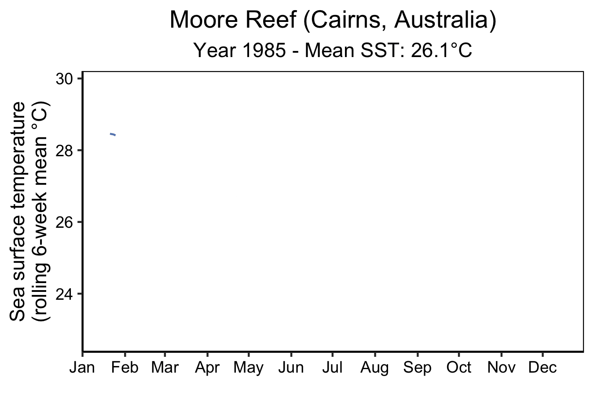

# NO(AA) worries

Tools for keeping a compact local copy of NOAA Coral Reef Watch (CRW) 5 km products and working with it in R: CoralTemp sea surface temperature (SST), degree heating weeks (DHW) and their monthly and annual summaries.

<p align="center">

</p>

## How it works

| Step | Tool | Result |
|---|---|---|
| Download, verify (md5), convert | `A_scripts/functions/crw_archive.py update` | one parquet file per NOAA file |
| Regional subset | `crw_archive.py extract` | per-year files sorted for time series |
| Read, extract points, heat stress | R functions in `A_scripts/functions/` | tibbles / Arrow datasets |

Python is needed only to build the archive (R cannot yet write the parquet encoding used). Reading needs only R with `arrow`.

## Archive format

Each file holds ocean cells only, as three columns:

| Column | Type | Meaning |
|---|---|---|
| `date` | date | day of the layer (first day for monthly and annual files) |
| `cell_id` | int32 | `iy * 7200 + ix` on the global 0.05° grid |
| `<product>_x100` | int16 | value × 100, e.g. `sst_x100 = 2815` is 28.15 °C |

Cell centres: `lon = -179.975 + 0.05 * ix`, `lat = 89.975 - 0.05 * iy`, where `ix = cell_id %% 7200` and `iy = cell_id %/% 7200`. Files use zstd compression with delta-encoded integers, about 22% smaller than the NOAA NetCDF files (measured on 35 annual SST files), and convert back to the original values exactly.

```
<root>/
  daily/<product>/year=YYYY/<product>_YYYYMMDD.parquet
  monthly/<product>/year=YYYY/<product>_YYYYMM.parquet
  annual/<product>/<product>_YYYY.parquet
  climatology/climatology.parquet
  regions/<region>/<timeframe>/<product>/<product>_<region>_YYYY.parquet
  regions/<region>/cells.parquet        cell_id, lon, lat
  manifest/manifest.parquet             source file, md5, date ingested
  raw/                                  NetCDF files (kept only with --keep-raw)
```

## Setup

1. Clone the repository and work from its root.
2. Install Python packages: `python3 -m pip install --user -r A_scripts/functions/requirements.txt`
3. Install R packages: `install.packages(c("arrow", "dplyr", "jsonlite", "tibble"))`
4. Set the data root. The first existing path under `roots` in `A_scripts/functions/crw_config.json` is used (`/QRISdata/Q5947/sst` on the HPC, `/Users/uqkbairo/MODRRAP/sst` locally). Override with the `CRW_ROOT` environment variable or `--root`.
5. Check the environment: `python3 A_scripts/functions/crw_archive.py check --network`

The check lists each required package and stops with installation instructions when one is missing. Every other command runs the same package check first.

## Building and updating

```bash
CRW="python3 A_scripts/functions/crw_archive.py"
$CRW update --product sst dhw --timeframe daily --years 1985-2026 --workers 8
$CRW update --product sst dhw --timeframe monthly annual
$CRW update --timeframe climatology
$CRW extract --region gbr --product sst dhw --timeframe daily monthly annual
$CRW status
```

`update` compares the NOAA server listing with the archive and fetches only missing files, so the same command builds the archive the first time and keeps it current afterwards. `--dry-run` lists what would be fetched. On an HPC, submit `B_hpc_scripts/update_archive.slurm` after adding the cluster's account, partition and Python environment lines.

The same steps are available from R: see `A_scripts/01_check_environment.R` to `A_scripts/04_read_and_dhw.R`.

## Reading in R

```r
library(dplyr)
invisible(lapply(list.files("A_scripts/functions", pattern = "\\.R$", full.names = TRUE), source))

# Daily SST at a coordinate, from the GBR subset
sst <- crw_read_points(lon = 146.23, lat = -16.87, product = "sst",
                       timeframe = "daily", region = "gbr")

# Lazy access to a whole dataset
crw_open("sst-mean", "annual", region = "gbr") %>%
  filter(date >= as.Date("2010-01-01")) %>%
  collect() %>%
  crw_scale()
```

## Degree heating weeks

`crw_hotspot()` and `crw_dhw()` follow the CRW v3.1 definitions:

- HotSpot: `HS = SST - MMM`, with negative values set to 0, where MMM is the maximum monthly mean climatology of the cell.
- DHW: sum over the 84 days (12 weeks) ending on a given day of `HS / 7`, counting only days with `HS >= 1 °C`. Units are °C-weeks.

Sources: [CRW 5 km methodology](https://coralreefwatch.noaa.gov/product/5km/methodology.php); Liu et al. (2014) *Remote Sensing* 6:11579–11606; Skirving et al. (2020) *Remote Sensing* 12:3856.

## Repository layout

| Path | Contents |
|---|---|
| `A_scripts/` | numbered example workflows |
| `A_scripts/functions/` | R functions, `crw_archive.py`, `crw_config.json`, `requirements.txt` |
| `A_scripts/legacy/` | superseded scripts |
| `B_hpc_scripts/` | SLURM job template |
| `C_gbr_data/` | GBR reef coordinates with matching `cell_id` (`gbr_reefs.csv`); larger local files are not tracked |
| `D_plots/` | figures |

All commands and scripts are run from the repository root.
